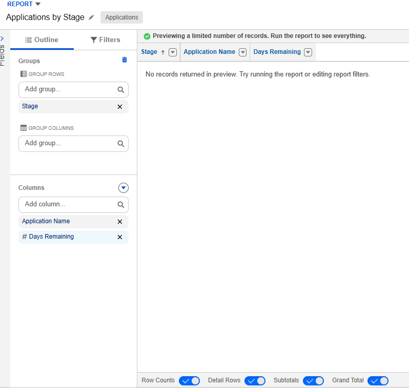
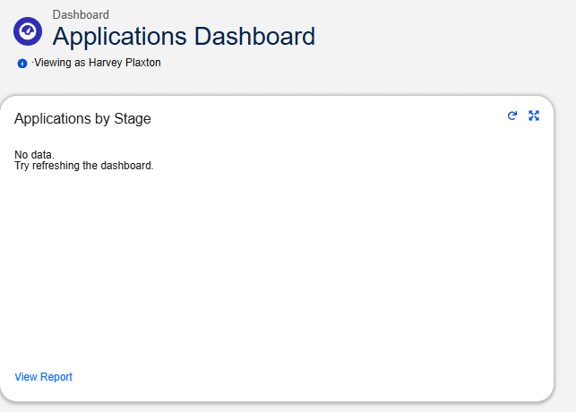
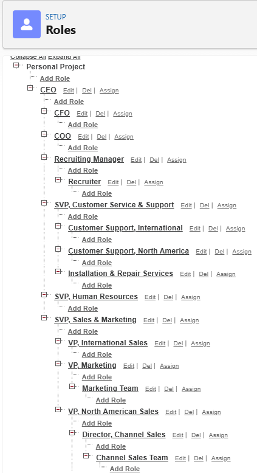

# Recruitment Tracker (Salesforce)

A learning project built while preparing for a Salesforce Developer role.

## Data model
- Candidate
- Position
- Application (master-detail to Position, lookup to Candidate)

## Progress
- [x] Week 1: data model, validation rules, Lightning app, sample data, reports, dashboards
- [x] Week 2: security model, roles, hierarchy, permissions
- [ ] Week 3-4: Flows and migration from Workflow Rules / Process Builder
- [ ] Week 6-7: Apex triggers and tests
- [ ] Week 8-9: Lightning Web Components and Aura

## Reports and dashboards (Week 1)
Built in the org and shown here as screenshots.

## Security model (Week 2)
- Org-wide default for Positions: Private
- Roles: Recruiter Manager (above) and Recruiter
- Permission set: Salary Viewer (field access to Salary Expectation)
- Test users (not stored in repo): one manager and one recruiter, checked with Login As

